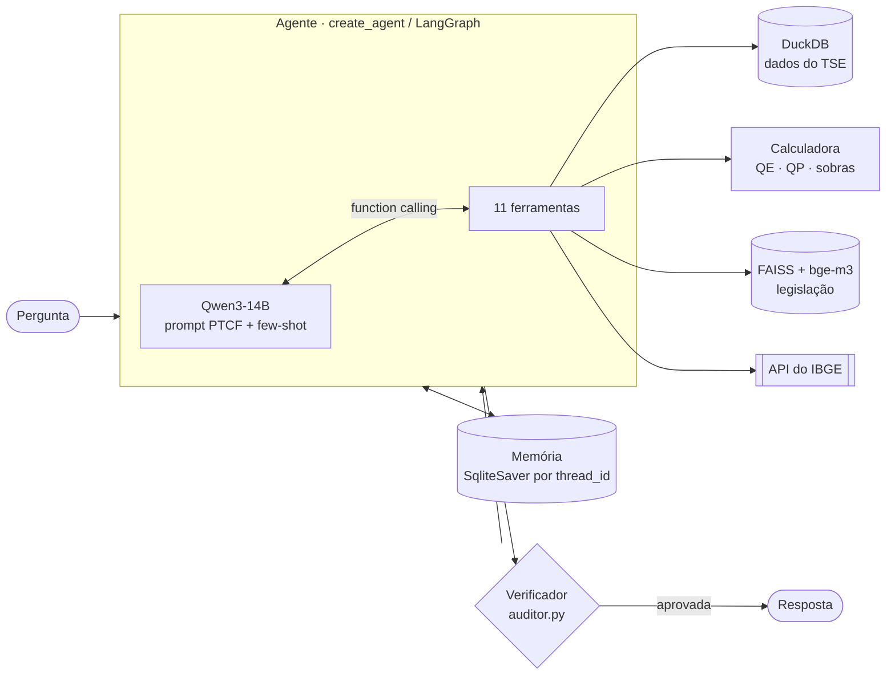

# Analista Eleitoral 2026

**Um agente de IA que explica a eleição para Deputado Federal de 2026 em São Paulo e na Bahia, com dados
oficiais do TSE, o cálculo exato do sistema proporcional e a legislação eleitoral citada artigo por artigo.**


-6B46C1)


> Projeto da disciplina **Agentes Cognitivos com LangChain** (Mestrado, Infnet).

---

## O problema

No sistema proporcional brasileiro, **ter muitos votos não garante a eleição**. As cadeiras vão primeiro para
os partidos e federações (quociente eleitoral, quociente partidário e sobras) e só depois para os candidatos,
na ordem de votação dentro de cada agremiação.

Por isso uma pergunta simples exige três coisas que um LLM sozinho não tem:

> *"Por que o Rui Falcão, com 106.443 votos, não foi eleito, se a Sônia Guajajara foi com 54.207?"*

1. os **dados oficiais** de 2026;
2. o **cálculo exato** do quociente e das sobras;
3. a **regra jurídica vigente**, incluindo a decisão do STF sobre as sobras.

O princípio do projeto: **quem calcula é o código; o LLM escolhe a ferramenta e redige.**

## Exemplo

```text
Você: Por que o Rui Falcão não foi eleito em SP?

Agente: Rui Falcão não foi eleito porque a federação dele (FE Brasil) conquistou 11 cadeiras e ele ficou em
12º lugar na lista interna; o último eleito, João Paulo Cunha, teve 109.548 votos, contra 106.443 dele.
Ele cumpria os mínimos individuais (31,5% do quociente eleitoral); o que faltou foi vaga para a federação.
Base legal: [Código Eleitoral, arts. 106 a 108]; [Código Eleitoral, art. 109, § 1º];
[Res.-TSE 23.677/2021, art. 11, § 8º].

   [ferramentas: explicar_candidato | verificação: ok | 125 s]
```

```text
Você: E quem ficou com a última vaga da federação dele?

Agente: João Paulo Cunha (PT), 109.548 votos, eleito por média. Primeiros suplentes: Rui Falcão (106.443),
Paulo Teixeira (106.062) e Reis (90.224).

   [ferramentas: eleitos_agremiacao | verificação: ok]
```

## Resultados

| O que foi medido | Resultado |
|---|---|
| Calculadora × resultado oficial do TSE | **109/109 eleitos** (SP 70/70, BA 39/39), inclusive o critério (quociente × média) |
| Recuperação na legislação (8 perguntas, artigo esperado) | bge-m3: **Hit@4 100%, MRR 0,88** · nomic-embed: 75%, 0,59 |
| Agente no LangSmith (14 perguntas com gabarito) | fatos **0,86** · trajetória superset **1,00** · precisão da trajetória **0,96** · verificação **1,00** |
| Tempo médio por pergunta (modelo local de 14B) | ~90 s |

Detalhes, falhas analisadas uma a uma e a evolução entre as rodadas estão no [relatório](RELATORIO.md).

## Arquitetura



| Camada | Implementação |
|---|---|
| Agente | `create_agent` (LangChain 1.x), que monta um grafo do LangGraph no ciclo ReAct; middleware de limite de chamadas e de resumo do histórico |
| Modelos | Qwen3-14B (agente) e bge-m3 (embeddings), locais no LM Studio, pela API compatível com a da OpenAI |
| Dados | ETL dos zips do TSE para DuckDB; banco aberto em modo somente leitura e sem acesso a arquivos externos |
| Cálculo | `calculadora.py`: Código Eleitoral, arts. 106 a 109; Res.-TSE 23.677/2021, arts. 11 e 12-A; ADI 7.228 |
| RAG | 1.116 trechos, **um por artigo**, de 6 documentos (CE, Lei 9.504, Res. 23.609/23.677/23.748, acórdão do STF); busca semântica e busca exata por artigo |
| Memória | Checkpointer SQLite do LangGraph por conversa + `SummarizationMiddleware` (taxonomia CoALA no relatório) |
| Verificação | `auditor.py`, determinístico: números e citações precisam vir das ferramentas; coerência com a conclusão da ferramenta; sem links inventados; resposta reprovada é reescrita uma vez |
| Observabilidade | Callback de logging (`BaseCallbackHandler`) e avaliação no LangSmith (dataset, experimento, avaliadores de resposta e de trajetória) |
| Interface | Notebook, chat no terminal e Streamlit |

### Ferramentas do agente

| Ferramenta | Tipo | O que faz |
|---|---|---|
| `explicar_candidato` | determinística | Por que alguém foi ou não eleito, com a **conclusão pronta** e a base legal do caso |
| `resultado_eleicao` | determinística | Recalcula as cadeiras da UF e confere com o TSE |
| `eleitos_agremiacao` | determinística | Eleitos, último eleito e suplentes de um partido ou federação |
| `mais_votados_uf` / `votos_por_municipio` | determinística | Rankings estadual e municipal (busca sem acento) |
| `esquema_banco` + `consultar_banco` | text-to-SQL | O modelo escreve o SQL; o código aceita só SELECT, aplica LIMIT e executa em modo leitura |
| `buscar_legislacao` | semântica | FAISS + bge-m3, com a citação [fonte, artigo] em cada trecho |
| `ler_artigo` | busca exata | Texto integral de um artigo, sem embedding |
| `perfil_municipio_ibge` | API externa | População do Censo 2022 (IBGE) cruzada com os votos do TSE |
| `analisar_financas` | determinística | Custo por voto e % do limite de gastos (alerta ≥ 90%, indício > 100%); dados não incluídos nesta versão |

## Como rodar

### Pré-requisitos

- Python 3.11+ (testado com 3.14 no Windows 11)
- [LM Studio](https://lmstudio.ai) com o servidor ligado e os modelos `qwen/qwen3-14b` (contexto de 16.384
  tokens) e `text-embedding-bge-m3`
- Os dados do TSE e a legislação: veja [`dados/LEIA-ME.md`](dados/LEIA-ME.md)

### Windows (scripts prontos)

| Passo | Script | O que faz |
|---|---|---|
| 0 | `0_instalar_ambiente.bat` | cria o `.venv`, instala as dependências e confere o ambiente |
| 1 | `1_carregar_dados.bat` | ETL dos zips do TSE para o DuckDB |
| 2 | `2_validar_calculadora.bat` | testes + recálculo comparado com o resultado oficial |
| 3 | `3_comparar_embeddings.bat` | indexa a legislação e compara nomic × bge-m3 |
| 4 | `4_testar_ferramentas.bat` | demonstra cada ferramenta sem LLM |
| 5 | `5_conversar.bat` | chat no terminal |
| 6 | `6_avaliar.bat` | avaliação com log próprio (14 perguntas) |
| 7 | `7_interface.bat` | interface Streamlit |
| 8 | `8_avaliar_langsmith.bat` | avaliação no LangSmith |

### Linux / macOS

```bash
python -m venv .venv && source .venv/bin/activate
pip install -r requirements.txt
cp .env.exemplo .env          # ajuste o endereço do LM Studio e, se quiser, a chave do LangSmith
python etl.py                 # carrega os dados
python db.py                  # valida a calculadora contra o TSE
python rag.py --comparar      # indexa a legislação
python agente.py              # chat no terminal
streamlit run app.py          # interface
python avaliacao_langsmith.py # avaliação (precisa de LANGSMITH_API_KEY)
```

O notebook [`projeto_agente_eleitoral.ipynb`](projeto_agente_eleitoral.ipynb) percorre o projeto fase a fase:
dados e calculadora → LLM isolado → chains (parser, LCEL × `@chain`, roteamento, paralelismo) → ferramentas →
RAG → memória → verificação → avaliação → interface.

### Testes

```bash
python -m pytest
```

56 testes: calculadora, ETL, RAG, ferramentas, API do IBGE (rede simulada), chains, callbacks, agente com
modelo roteirizado (incluindo o resumo do histórico), verificador, avaliação, avaliadores do LangSmith e a
interface Streamlit. Dois deles conferem o recálculo com o resultado oficial e rodam quando o banco existe.

## Estrutura

```text
├── config.py               caminhos, recorte (SP e BA) e modelos
├── etl.py                  zips do TSE → DuckDB (tabelas brutas + views)
├── db.py                   conexão somente leitura e recálculo por UF
├── calculadora.py          sistema proporcional (QE, QP, mínimo de 10%, sobras 80/20 e fase final)
├── financas.py             indicadores de prestação de contas (alerta / indício)
├── rag.py                  PDFs → chunks por artigo → FAISS; avaliação Hit@4 / MRR
├── tools.py                as 11 ferramentas (@tool)
├── prompts.py              prompt PTCF com few-shot (PromptTemplate)
├── chains.py               parser Pydantic, LCEL, @chain, RunnableBranch, RunnableParallel
├── agente.py               create_agent + memória SQLite + verificação
├── auditor.py              verificador determinístico da resposta
├── callbacks.py            log de ferramentas e chamadas ao modelo
├── avaliacao.py            avaliação com gabarito e trajetória (log próprio)
├── avaliacao_langsmith.py  dataset, experimento e avaliadores no LangSmith
├── legado.py               as mesmas ferramentas com APIs clássicas, para comparação
├── app.py                  interface Streamlit
├── projeto_agente_eleitoral.ipynb
├── RELATORIO.md            decisões, resultados, análise comparativa e limitações
├── evidencias/             registros de cada rodada de teste, avaliações e prints
├── testes/
└── dados/                  tse/, legislacao/ (não versionados) e artefatos/ (gerados)
```

## O que o projeto ensinou

- **Com um modelo pequeno, confiabilidade vem do código, não do prompt.** O Qwen3-14B lia os números certos e
  tirava a conclusão errada ("31,5% não atinge 20%"). A solução foi entregar a conclusão pronta na ferramenta
  e verificar a resposta.
- **A verificação evoluiu com os erros.** Primeiro só números e citações; depois coerência com a conclusão,
  quando apareceu um erro de raciocínio com números verdadeiros.
- **Avaliador também precisa ser auditado.** O gabarito por padrão de texto aprovou uma resposta errada que
  usava as mesmas palavras; as falhas foram lidas uma a uma.
- **Escolher embedding por medição.** Para legislação em português, o bge-m3 superou o nomic-embed com folga.

## Limitações

- Latência alta (~90 s por pergunta) com o modelo local.
- O verificador não detecta citação real que não seja a pertinente, nem resposta certa para a pergunta errada.
- O critério de desempate de médias ainda é lido de forma errada pelo modelo em parte das execuções.
- Prestação de contas: módulo pronto e testado com dados sintéticos; dados do TSE não incluídos.
- Escopo: apenas Deputado Federal 2026, SP e BA.

## Uso de IA

O desenvolvimento teve apoio do assistente Claude (Anthropic) em código, testes e documentação. As decisões de
escopo, a coleta dos dados, a execução de todas as etapas e a revisão dos resultados foram do autor; o
[relatório](RELATORIO.md) detalha o processo. Os modelos avaliados rodaram localmente no LM Studio.

## Fontes

- Dados: [Portal de Dados Abertos do TSE](https://dadosabertos.tse.jus.br)
- Legislação: [TSE — legislação compilada](https://www.tse.jus.br/legislacao) e STF (ADIs 7.228, 7.263 e 7.325)
- População: [API de dados agregados do IBGE](https://servicodados.ibge.gov.br/api/docs/agregados?versao=3) (Censo 2022)

## Autor

**David Mercado** — Pos-graduação, Infnet.
