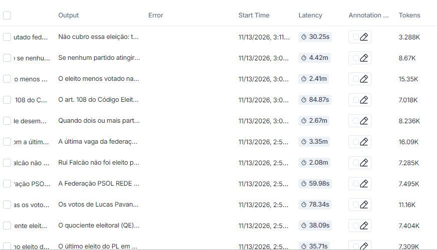

# Agente Analista Eleitoral 2026 — Relatório (rascunho)

**Disciplina:** Agentes Cognitivos com LangChain (Infnet) · **Autor:** David Mercado · **Data:** 13/11/2026

## 1. Problema e domínio

No sistema proporcional brasileiro, ser bem votado não garante a eleição: as cadeiras são primeiro das
agremiações (partidos e federações) e só depois dos candidatos. Perguntas como "por que o candidato X, com mais
votos que Y, não foi eleito?" exigem três coisas que um LLM sozinho não tem: os **dados oficiais** de 2026, o
**cálculo exato** (quociente eleitoral, quociente partidário, sobras) e a **regra jurídica** vigente.

O agente responde perguntas sobre a eleição para **Deputado Federal de 2026 em São Paulo (70 vagas) e na Bahia
(39 vagas)**, com quatro capacidades: consulta aos dados, recálculo da distribuição de cadeiras, explicação de
casos individuais e consulta à legislação com citação do artigo.

**Dados:** TSE (dados abertos) — `consulta_cand_2026`, `consulta_vagas_2026`, `votacao_candidato_munzona_2026`
e `votacao_partido_munzona_2026`: 1.667 candidaturas e 1.039.955 linhas de votação, carregadas em DuckDB.
**Legislação (RAG):** Código Eleitoral, Lei 9.504/1997, Res.-TSE 23.609/2019, 23.677/2021 e 23.748/2026 e o
acórdão do STF na ADI 7.228 — 1.116 trechos.

## 2. Arquitetura cognitiva

```
pergunta → agente (create_agent, qwen3-14b no LM Studio, prompt PTCF)
             ├─ dados: mais_votados_uf, votos_por_municipio, eleitos_agremiacao, esquema_banco + consultar_banco (text-to-SQL)
             ├─ cálculo: resultado_eleicao, explicar_candidato  → calculadora.py (determinística)
             ├─ legislação: buscar_legislacao (FAISS + bge-m3), ler_artigo (busca exata)
             ├─ API externa: perfil_municipio_ibge (IBGE, Censo 2022)
             └─ finanças: analisar_financas
           → verificador (auditor.py) → aprovado? resposta : reescrita única com a lista de problemas
memória: checkpointer SQLite por thread_id + resumo automático do histórico · log: callback LogAgente
interfaces: notebook, chat no terminal, Streamlit
```

**Anatomia**

| Componente | Implementação |
|---|---|
| Percepção | pergunta em linguagem natural; intenção e entidades extraídas em JSON (`chains.py`) |
| Raciocínio / planejamento | ciclo ReAct do `create_agent` (pensar → ferramenta → observar → repetir); passo a passo explícito no prompt (intenção → entidades → ferramenta → conferência); limite de 10 chamadas; replanejamento quando o verificador reprova |
| Memória | trabalho, episódica, semântica e procedimental (seção 3.2) |
| Ação | 11 ferramentas (hardcoded, text-to-query, semânticas e API externa) |
| Verificação | `auditor.py` + reescrita única |

**Tipo:** agente único, *tool-augmented*, padrão ReAct com *function calling*, com verificador externo
determinístico. **Nível de maturidade agêntica** (escala: 1 LLM isolado, 2 chain fixa, 3 chain com roteamento,
4 agente com ferramentas e memória, 5 agente com verificação e autocorreção, 6 multiagente/planejamento
hierárquico): **nível 5**. O agente escolhe as ferramentas, mantém contexto e corrige a resposta quando a
verificação falha; não faz planos longos nem coordena outros agentes.

**Planejamento e memória aumentada:** o planejamento é reativo e passo a passo (ReAct); a memória é aumentada
por recuperação — fatos eleitorais e legislação não ficam no modelo nem no contexto, são buscados no banco e no
índice vetorial; o histórico longo é resumido.

Princípio central: **quem calcula é o código; o LLM escolhe a ferramenta e redige.**

### 2.1 Escolha do orquestrador

| Orquestrador | Ponto forte | Avaliação para este problema |
|---|---|---|
| **LangChain 1.x + LangGraph** | ferramentas, RAG, SQL, memória (checkpointer), middleware e LangSmith integrados; usa o LM Studio pela API OpenAI | **escolhido**: um agente com ferramentas heterogêneas, memória e avaliação |
| LlamaIndex | ingestão e consulta de documentos | forte em RAG, menos completo para SQL + cálculo + memória por conversa |
| CrewAI | equipes de agentes com papéis | o problema não exige vários agentes; multiplica chamadas a um LLM local já lento |
| AutoGen | conversa entre agentes, geração de código | idem, foco multiagente |
| Semantic Kernel | integração .NET/Azure | ecossistema menos alinhado ao Python/DuckDB |

## 3. Decisões por fase

| Fase | O que foi feito | Decisão e motivo |
|---|---|---|
| 0. Dados | ETL dos zips do TSE para DuckDB; views tipadas | DuckDB lê CSV direto e roda local. Federação tratada como uma agremiação única. Banco aberto somente para leitura e sem acesso a arquivos externos. |
| 0. Calculadora | QE (art. 106), QP com mínimo de 10% (arts. 107-108), sobras 80/20 e fase final sem barreira (art. 109; ADI 7.228), desempates da Res. 23.677, art. 11, §§ 6º-7º | Lógica pura, sem LLM, **validada contra o resultado oficial** antes de ser usada pelo agente. |
| 1. LLM isolado | Mesma pergunta sem ferramentas | Linha de base: o modelo não tem os dados de 2026. |
| 2. Chain MVP | `prompt \| llm.with_structured_output(Classificacao)` com `Literal` | Categoria fechada permite decidir em código; evita interpretar texto livre. |
| 3. Ferramentas | 10 ferramentas `@tool`; Text-to-SQL com validação (só SELECT/WITH, lista de comandos proibidos, LIMIT) | Ferramentas específicas devolvem a **conclusão pronta**; o SQL livre fica como último recurso. |
| 4. RAG | Um chunk por artigo, com a citação nos metadados; busca semântica + busca exata por artigo | Em texto legal, o artigo é a unidade de sentido e de citação. Embedding escolhido por medição (seção 5.2). |
| 5. Memória | `SqliteSaver` por `thread_id`; `SummarizationMiddleware`; limite de 10 chamadas ao modelo | CoALA: trabalho (mensagens), episódica (checkpointer), semântica (banco e legislação via ferramentas), procedimental (prompt). |
| 6. Verificação | `auditor.py`: números, citações, links, coerência com a CONCLUSÃO da ferramenta, linguagem de prestação de contas | Determinístico: barato, reproduzível e independente do modelo avaliado. |
| 7. Avaliação | 14 perguntas com gabarito; métricas de resposta, trajetória (superset), verificação e tempo; log próprio em JSONL | Gabarito extraído do banco, não de outro LLM. Juiz LLM com `Literal` implementado como opção. |
| 2b. Chains | `PydanticOutputParser` com correção do JSON e falha segura; pipeline sequencial em LCEL; o mesmo fluxo com `@chain`; `RunnableBranch` (roteamento por intenção); `RunnableParallel` (SP e BA juntos); `invoke`, `batch` e `stream` | Declarativo para o caminho fixo (ganha batch/stream/paralelo/tracing); imperativo para desvios e regras de negócio (seção 3.1). |
| 3b. API externa | `perfil_municipio_ibge`: API pública do IBGE (Censo 2022) cruzada com os votos do TSE | APIs internas (DuckDB, FAISS) são chamadas sempre; a externa só quando a pergunta envolve população, com tempo limite, cache e falha convertida em mensagem. |
| 5b. Prompt | Template PTCF (`PromptTemplate` com o recorte como variável), few-shot (4 exemplos pergunta → ação → resposta) e passo a passo de raciocínio | Few-shot fixa o formato e a escolha de ferramenta; o raciocínio do Qwen3 fica curto (`/no_think`) por latência, mas o prompt impõe a sequência intenção → entidades → ferramenta → conferência. |
| 6b. Confiabilidade | Callback `LogAgente` (`BaseCallbackHandler`) registra cada ferramenta e chamada ao modelo com duração | Observa o agente de fora; vale para qualquer ferramenta nova. |
| 6c. Clássicos | `legado.py`: `initialize_agent` (ReAct) + `ConversationBufferMemory`, `create_openai_tools_agent` + `AgentExecutor` + `RunnableWithMessageHistory`, `LLMRouterChain` | Rodam sobre as mesmas ferramentas, para comparação; o agente principal usa as APIs atuais (seção 3.3). |
| 7b. LangSmith | Dataset de 14 exemplos e experimento com `evaluate()`: fatos, trajetória (superset e precisão), verificação e juiz opcional | Métricas de trajetória no mesmo lugar dos traces. |
| 8. Interface | `app.py` em Streamlit: chat com memória por sessão, ferramentas e verificação visíveis | Mesmo agente do notebook. |

APIs usadas: LangChain 1.x (`create_agent`, middleware, `with_structured_output`) e LangGraph (checkpointer).
Não foram usados `AgentExecutor`, `RunnableWithMessageHistory` nem `create_openai_tools_agent`.

### 3.1 Composição declarativa × imperativa

| | Declarativa (LCEL) | Imperativa (`@chain`) |
|---|---|---|
| Forma | `a \| b \| c`, `RunnableParallel`, `RunnableBranch` | função Python decorada |
| Ganha de graça | batch, stream, async, paralelismo, tracing | if/try/laços, regras de negócio, logs no meio |
| No projeto | `classificar \| rotear \| redigir` | mesmo fluxo com desvio para fora de escopo e para "candidato não encontrado" sem chamar o LLM |

### 3.2 Memória (CoALA) e janela de contexto

| Memória | Prazo | Implementação |
|---|---|---|
| Trabalho | curto | mensagens da conversa no estado do grafo |
| Episódica | longo | `SqliteSaver` por `thread_id`, persiste entre execuções |
| Semântica | longo | DuckDB (TSE) e FAISS (legislação), via ferramentas |
| Procedimental | longo | prompt PTCF e código das ferramentas |

Janela de contexto: `SummarizationMiddleware` resume o histórico quando passa do gatilho e mantém só as últimas
mensagens; a busca vetorial traz o conhecimento sob demanda. Demonstrado no notebook com gatilho de 4
mensagens e coberto por teste automatizado.

**Ferramentas especializadas de memória**

| Ferramenta | Arquitetura | Caso de uso | Para este projeto |
|---|---|---|---|
| Checkpointer LangGraph (usado) | estado do grafo serializado por conversa | retomar conversas, auditoria | suficiente: conversas curtas, tudo local |
| LangGraph Store / LangMem | chave-valor com busca semântica entre conversas | preferências e fatos do usuário | útil se fosse preciso lembrar o usuário entre conversas |
| Mem0 | extração e consolidação de fatos com LLM + vetor/grafo | assistentes pessoais | uma chamada extra ao LLM por turno; modelo local lento |
| Zep | serviço com grafo temporal e resumos | memória de longo prazo em produção | exige servidor; excessivo |
| Letta (MemGPT) | memória hierárquica editada pelo agente | agentes de vida longa | complexo; o conhecimento aqui é estável |
| ConversationBufferMemory (clássico) | histórico inteiro no prompt | chatbots simples | estoura o contexto em conversas longas; demonstrado em `legado.py` |

### 3.3 APIs clássicas × atuais

| Clássico (rubrica, em `legado.py`) | Atual (agente principal) | Motivo da escolha |
|---|---|---|
| `initialize_agent`, `AgentExecutor`, `create_openai_tools_agent` | `create_agent` | estado em grafo, middleware (limite de chamadas, resumo), menos código de cola |
| `ConversationBufferMemory`, `RunnableWithMessageHistory` | checkpointer + `SummarizationMiddleware` | persistência por conversa e controle da janela de contexto |
| `LLMRouterChain` | `RunnableBranch` / o próprio agente | roteamento em código, sem depender do LLM formatar JSON |

### 3.4 Tipos de ferramenta

| Tipo | Ferramentas |
|---|---|
| Hardcoded (determinísticas) | `resultado_eleicao`, `explicar_candidato`, `mais_votados_uf`, `eleitos_agremiacao`, `votos_por_municipio`, `analisar_financas` |
| Text-to-query | `esquema_banco` + `consultar_banco` (só SELECT, banco somente leitura, sem acesso a arquivos) |
| Semânticas | `buscar_legislacao` (FAISS + bge-m3) |
| Busca exata | `ler_artigo` |
| API externa | `perfil_municipio_ibge` (IBGE) |

## 4. Resultados

### 4.1 Calculadora × resultado oficial do TSE

| UF | Vagas | Votos válidos | QE | Eleitos coincidentes | Por QP / por média |
|---|---|---|---|---|---|
| SP | 70 | 23.674.188 | 338.203 | 70/70 | 60 / 10 (igual ao TSE) |
| BA | 39 | 8.281.816 | 212.354 | 39/39 | 33 / 6 (igual ao TSE) |

Casos que o agente explica: Rui Falcão (106.443 votos, não eleito: 12º de uma federação com 11 cadeiras, embora
com mais votos que a eleita menos votada, 54.207); Federação PSOL REDE em SP (QP 9, mas 6 cadeiras: só 6
candidatos com 10% do QE); Lucas Pavanato (3.038.438 votos = 8,98 QE).

### 4.2 Avaliação do agente (qwen3-14b, 12/11/2026, 14 perguntas, log próprio)

| Métrica | Resultado |
|---|---|
| Respostas corretas (fatos do gabarito) | **79%** (11/14) |
| Trajetória correta (ferramentas esperadas) | **93%** (13/14) |
| Aprovadas na verificação final | **93%** (2 reescritas pelo verificador) |
| Tempo médio por pergunta | **104 s** |

Falhas:

| # | Pergunta | O que aconteceu |
|---|---|---|
| 1 | 3 mais votados em SP | Interpretou "SP" como o município e devolveu o ranking da capital. Números reais, pergunta errada — o verificador não detecta. |
| 8 | Por que o PSOL REDE ficou abaixo do QP | A ferramenta não trazia o motivo; o modelo respondeu de forma vaga, sem citar a regra dos 10%. |
| 11 | Desempate de médias | Citou o 2º critério (§ 7º) em vez do 1º (§ 6º) e **inventou um link**; o verificador acusou o número do link e a resposta saiu com aviso. |

Correções feitas depois desta rodada: ferramenta `mais_votados_uf` (ranking estadual); `resultado_eleicao`
passa a explicar a diferença entre QP e cadeiras (mínimo de 10% do QE, art. 108); proibição de links no prompt
e no verificador.

**Reavaliação das 3 falhas (12/11/2026, 21h05):**

| # | Resultado | Observação |
|---|---|---|
| 1 | correto | Usou `mais_votados_uf`: Pavanato (3.038.438), Erika Hilton (1.596.472), Sâmia Bomfim (583.107). |
| 8 | correto | Explicou que só 6 candidatos atingiram 10% do QE (33.820 votos), citando o art. 108. |
| 11 | **falso positivo da métrica** | Sem link inventado, mas ainda erra o 1º critério: diz "maior votação nominal dos candidatos" (é o 2º, § 7º); o 1º é a maior votação do partido (§ 6º). O padrão do gabarito ("maior vota") aceitou a resposta; foi endurecido depois disso. |

Resultado consolidado (rodada completa + reavaliação, repontuado no notebook com o gabarito atual, que reprova a 11): **13/14 (93%)** respostas
corretas e **14/14 (100%)** trajetórias corretas.

Lição: um gabarito por padrão de texto pode aprovar uma resposta errada que usa as mesmas palavras. É o caso
em que o juiz LLM ou a revisão humana são necessários.

### 4.3 Avaliação no LangSmith (13/11/2026)

Experimento **`qwen-qwen3-14b-dacdec64`** sobre o dataset `agente-eleitoral-2026` (14 exemplos), com a versão
final do agente (prompt PTCF, 11 ferramentas, verificador). Tabela completa em
`evidencias/langsmith_qwen-qwen3-14b-dacdec64.csv`; traces com a trajetória de cada pergunta no LangSmith.

| Avaliador | Média | Leitura |
|---|---|---|
| `fatos` | **0,86** (12/14) | resposta contém o gabarito e nenhum fato proibido |
| `trajetoria_superset` | **1,00** (14/14) | todas as ferramentas esperadas foram chamadas; fora de escopo sem ferramenta |
| `trajetoria_precisao` | **0,96** | só uma chamada desnecessária (pergunta 5: `buscar_legislacao` extra) |
| `verificacao` | **1,00** | todas aprovadas no auditor; 2 precisaram ser reescritas (perguntas 5 e 7) |

Tempo médio: ~91 s por pergunta (de 30 s, fora de escopo, a 265 s, legislação).



*Experimento `qwen-qwen3-14b-dacdec64`: cada linha é um trace (pergunta, resposta, latência, tokens).*

**As duas respostas reprovadas em `fatos`:**

| # | Resposta | Diagnóstico |
|---|---|---|
| 8 | Explica corretamente que só 6 candidatos do PSOL REDE atingiram 10% do QE (33.820 votos) e que 3 vagas foram para as sobras, mas não escreve o QP 9 | **falso negativo da métrica**: o conteúdo está certo; o gabarito exigia o número 9 explícito |
| 11 | Cita o desempate pelos votos nominais do candidato (§ 7º) como se fosse o primeiro critério; o primeiro é a maior votação do partido (§ 6º) | **erro real**, o mesmo das rodadas anteriores; o trecho certo é recuperado, mas o modelo lê o parágrafo errado |

**O que as métricas não mostram (lido nas respostas):**
- Pergunta 4: o QE está certo (338.203), mas a base legal citada é o art. 108 (o QE é o art. 106). A citação
  existia na saída da ferramenta, então o verificador aceitou — ele confere a *origem* da citação, não se ela é a
  pertinente.
- Pergunta 5: resposta certa (Felix Mendonça, 60.159, sobras 80/20), mas citou a Lei 9.504, art. 80, trazido
  pela busca extra e sem relação com o caso.

**Conclusões:**
1. A **trajetória** está resolvida: com ferramentas específicas e o prompt com few-shot, o agente escolhe a
   ferramenta certa em 14/14 e quase não faz chamadas inúteis (precisão 0,96).
2. Os erros que restam são de **leitura e redação**, não de dados: escolher o parágrafo certo da lei e a citação
   pertinente. É onde um modelo maior ou um juiz LLM ajudaria.
3. Comparação com a avaliação de log próprio (seção 4.2): 79% → 93% (após correções) → 86% no LangSmith. A
   diferença para 93% vem da pergunta 8, que agora omitiu o número 9 — a variação entre execuções de um modelo
   local é da ordem de 1 pergunta em 14, e uma única execução não basta para distinguir versões tão próximas.
4. A métrica por padrão de texto tem falsos positivos (pergunta 11 na rodada anterior) e falsos negativos
   (pergunta 8 aqui); por isso as falhas foram lidas uma a uma.

### 4.4 Diagnóstico de falha de recuperação (RAG)

Na primeira indexação (nomic-embed sem prefixos de tarefa), a pergunta "o que acontece se nenhum partido
atingir o quociente eleitoral?" devolveu Lei 9.504 art. 9, Código Eleitoral art. 90 e Res. 23.677 art. 12 —
nenhum trata do caso; os corretos são CE art. 111 e Res. 23.677 art. 12-A. Diagnóstico pelos documentos
devolvidos: o modelo associava termos genéricos ("partido", "eleição") e não o sentido da pergunta, por dois
motivos — falta dos prefixos `search_query:`/`search_document:` exigidos pelo nomic e modelo treinado
sobretudo em inglês. Correção: prefixos e troca por bge-m3 (multilíngue), escolhida por medição em 8
perguntas (seção 5.2). Depois da troca, a mesma pergunta traz CE art. 111 e Res. 23.677 art. 12-A nas duas
primeiras posições.

### 4.5 Achados da execução completa do notebook (13/11/2026) e correções

| Achado | Causa | Correção |
|---|---|---|
| Erro 400 do LM Studio ao rodar o notebook pela 2ª vez | o notebook reaproveitava os mesmos `thread_id`; a memória SQLite acumulou as duas execuções e estourou a janela de contexto | ids novos a cada execução; resumo do histórico disparado mais cedo (4.000 tokens) |
| Depois do resumo, "o agente não produziu resposta" | as mensagens novas eram separadas pela posição na lista; quando o resumo dispara o histórico encolhe | mensagens novas identificadas pelo id; teste automatizado do resumo |
| Chain sem agente inventou o motivo da não eleição do Rui Falcão ("não atingiu 10%") | classificação errada (`resultado_uf`) + redator sem verificação | candidato citado vai sempre para `explicar_candidato` |
| API do IBGE "indisponível" | a API responde compactada (gzip) | descompressão automática; teste com resposta gzip |
| Executor clássico respondeu sobre a federação errada no 2º turno | o histórico (`RunnableWithMessageHistory`) chegou, mas o modelo resolveu "dele" errado | mantido como evidência da comparação clássico × atual |

## 5. Análise comparativa

### 5.1 LLM isolado × chain × agente

| Etapa | Pergunta | Resultado |
|---|---|---|
| LLM isolado (Fase 1) | "Por que o Rui Falcão não foi eleito em SP em 2026?" | O modelo responde como se estivesse em 2024 ("ainda não ocorreram as eleições de 2026") e lista fatores genéricos (campanha, popularidade). Não tem os dados nem faz o cálculo. |
| Chain com saída estruturada (Fase 2) | Classificar 3 perguntas | Sempre devolve uma categoria válida do `Literal`, mas erra uma: "O que diz o art. 108 do Código Eleitoral?" vira `fora_de_escopo`. |
| Agente (Fases 5-6) | Mesma pergunta do Rui Falcão | 12º lugar numa federação com 11 cadeiras; último eleito com 109.548 votos contra 106.443; base legal (CE arts. 106-109; Res. 23.677, art. 11, § 8º). Verificação aprovada. |

Na avaliação, o agente acerta os fatos em 79% das perguntas na primeira rodada e em 93% após as correções.

### 5.2 Modelos de embedding (8 perguntas, artigo esperado entre os 4 primeiros)

| Modelo | Hit@4 | MRR |
|---|---|---|
| nomic-embed-text-v1.5 (com prefixos de tarefa) | 75% | 0,59 |
| **bge-m3** | **100%** | **0,88** |

O nomic, treinado principalmente em inglês, errou as perguntas sobre federações e desempate. Adotado o bge-m3.

### 5.3 Modelos de chat
Teste qualitativo (mesma pergunta sobre o "puxador de votos"): qwen3-14b e gpt-oss-20b erraram antes dos
ajustes; o gpt-oss-20b escolheu a ferramenta errada, inventou afirmações e exigiu mais memória (falhou ao
carregar junto com outros modelos). Mantido o qwen3-14b. Não houve rodada completa com o gpt-oss-20b.

### 5.4 Agente sem × com verificação (evolução registrada em `evidencias/`)

| Rodada | Situação | Erros observados |
|---|---|---|
| 1 (sem verificação) | 5 perguntas | Motivo errado ("31,5% não atinge 20%"), critério de eleição errado, resposta de lei sem ferramenta e com artigo errado |
| 2 (ferramentas com CONCLUSÃO) | 4 perguntas | Números inventados (1.386.945 votos; 4,1 QE); falha na busca por município com acento |
| 3-4 (verificador de números e citações) | 4 perguntas | Raciocínio invertido com números reais ("nenhuma cadeira sozinho"), aprovado indevidamente |
| 5 (verificador de coerência) | 14 perguntas | 79% / 93% / 93% (seção 4.2) |
| 6 (correções de ferramentas) | 3 falhas reavaliadas | consolidado 93% respostas / 100% trajetória |

## 6. Limitações

- **Modelo local pequeno:** o qwen3-14b interpreta mal saídas longas; a qualidade depende de as ferramentas
  entregarem a conclusão pronta. Latência média de 104 s por pergunta.
- **Verificador:** confere números, citações, links e a coerência com a conclusão da ferramenta; **não** detecta
  resposta correta para a pergunta errada (falha 1), omissões, nem citação que veio da ferramenta mas não é a
  pertinente (perguntas 4 e 5 no LangSmith).
- **Avaliação:** 14 perguntas, um modelo; o critério de fatos usa padrões de texto e aprovou indevidamente uma
  resposta (pergunta 11). O juiz LLM exige carregar um segundo modelo no LM Studio.
- **APIs clássicas:** demonstradas em `legado.py` e testadas com modelos simulados; o ReAct em texto
  (`initialize_agent`) depende de o modelo seguir o formato Thought/Action, mais frágil que o function calling.
- **API externa:** depende de internet; sem rede, a ferramenta do IBGE devolve uma mensagem de indisponibilidade.
- **Prestação de contas (decisão de escopo):** o módulo `financas.py` e a ferramenta `analisar_financas` foram
  construídos e testados com dados sintéticos (custo por voto, % do limite de gastos, ALERTA >= 90% e INDÍCIO
  > 100%, sem nunca afirmar irregularidade). Por prazo, os dados do TSE e os limites de gastos
  (Res. 23.766/2026) ficaram fora desta entrega; o agente informa que não tem esses dados (pergunta 12 da
  avaliação, acerto). A ETL já cria a view `financas_candidato` automaticamente quando os arquivos forem
  colocados em `dados/tse/` — é o primeiro trabalho futuro.
- **Regras não modeladas:** desempate por idade entre candidatos da mesma agremiação (Res. 23.677, art. 12);
  não afetou o resultado de 2026 nas duas UFs.
- **Referência ambígua sem contexto:** numa conversa nova, "a federação dele" deveria gerar uma pergunta de
  esclarecimento; o agente escolheu um referente por conta própria (Federação PSOL REDE).
- **Escopo:** apenas Deputado Federal, SP e BA, 2026. Sem dados de comparecimento, brancos e nulos.

## 7. Evidências

- `evidencias/`: 5 registros de teste manual (fases 6-7) e a avaliação completa (`avaliacao_*.jsonl` e `.md`),
  com respostas, chamadas de ferramentas, problemas do verificador e tempos.
- 54 testes automatizados (`pytest`): calculadora, ETL, RAG, ferramentas, API do IBGE (rede simulada), chains,
  callbacks, agente (modelo roteirizado, incluindo o resumo da janela), APIs clássicas, verificador,
  avaliação, avaliadores do LangSmith e interface Streamlit (AppTest); 2 deles conferem o recálculo com o
  resultado oficial.
- `evidencias/log_agente.jsonl`: eventos do callback (ferramentas, chamadas ao modelo e tempos).
- `evidencias/langsmith_qwen-qwen3-14b-dacdec64.csv` e `langsmith_experimento.png`: experimento no LangSmith.
- `evidencias/streamlit_interface.png`: a interface em uso (pergunta sobre o município mais votado do Pavanato).
- Notebook `projeto_agente_eleitoral.ipynb` (fases 0 a 7) e vídeo da execução.

## 8. Uso de IA

O projeto foi desenvolvido com apoio do assistente Claude (Anthropic), usado para planejamento, escrita do
código, dos testes, do notebook e do rascunho deste relatório.

**Decisões e trabalho do autor:** escolha do tema (eleições, dados do TSE) e do recorte (Deputado Federal 2026,
SP e BA); escolha do DuckDB, do LM Studio com modelos locais e da entrega em notebook, sem Streamlit; inclusão
do módulo de prestação de contas e a decisão de deixá-lo sem dados nesta entrega; download dos dados do TSE, da
legislação e do acórdão da ADI 7.228; execução no próprio computador de todas as etapas (instalação, carga,
validação da calculadora, comparação de embeddings, testes, conversas com o agente, avaliação e notebook);
relato dos erros observados em cada rodada, que orientaram as correções; revisão dos resultados e do texto.

**Verificação do que a IA produziu:** a calculadora foi validada contra o resultado oficial do TSE (109 de 109
eleitos); o código tem 38 testes automatizados; as respostas do agente foram conferidas com o banco; os erros do
próprio processo (respostas erradas do agente, falso positivo do gabarito) estão documentados em `evidencias/` e
neste relatório. Os modelos avaliados (qwen3-14b, gpt-oss-20b, bge-m3, nomic) rodaram localmente no LM Studio.

## 9. Como executar

`0_instalar_ambiente.bat` (+ `0b_atualizar_ambiente.bat`) → `1_carregar_dados.bat` → `2_validar_calculadora.bat` → `3_comparar_embeddings.bat`
→ `4_testar_ferramentas.bat` → `5_conversar.bat` (chat no terminal) / `6_avaliar.bat` (avaliação, log
próprio) / `7_interface.bat` (Streamlit) / `8_avaliar_langsmith.bat` (LangSmith) / notebook.


## Apêndice — Onde cada item da rubrica é atendido

| Item | Onde |
|---|---|
| 1.1 Anatomia, tipo e maturidade | Seção 2; notebook "Arquitetura cognitiva" |
| 1.2 Planejamento e memória aumentada | Seções 2 e 3.2; `agente.py` |
| 1.3 PromptTemplate / ChatPromptTemplate | `prompts.py` (PromptTemplate PTCF); `chains.py`; notebook Fases 2 e 2b |
| 1.4 Output parser JSON | `chains.py` (`PydanticOutputParser` + correção); notebook Fase 2b |
| 1.5 Runnable (invoke, batch, stream) e `@chain` | `chains.py`; notebook Fase 2b |
| 1.6 LCEL e justificativa | `chains.py`; seção 3.1 |
| 2.1 Comparação de orquestradores | Seção 2.1 |
| 2.2 Agente com ferramentas, memória, ReAct, `initialize_agent` | `agente.py`; `legado.agente_initialize`; notebook Fases 5 e 6b |
| 2.3 Chains sequenciais/paralelas e RouterChain | `chains.py` (LCEL sequencial, `RunnableParallel`, `RunnableBranch`); `legado.roteador_classico` (`LLMRouterChain`) |
| 2.4 API externa via function calling | `tools.perfil_municipio_ibge` (IBGE) |
| 2.5 PTCF, few-shot e chain-of-thought | `prompts.py` |
| 2.6 Confiabilidade | parser com correção (`chains.py`), memória (`agente.py`), FAISS (`rag.py`), callbacks (`callbacks.py`), verificador (`auditor.py`) |
| 3.1 CoALA curto × longo prazo | Seção 3.2; notebook Fase 5 |
| 3.2 Janela de contexto: resumo + busca vetorial | `SummarizationMiddleware` + FAISS; notebook Fase 5; `test_agente.py` |
| 3.3 Ferramentas de memória comparadas | Seção 3.2 |
| 3.4 ConversationBufferMemory | `legado.chatbot_buffer`; notebook Fase 5 |
| 3.5 Intenção e entidades | `chains.Intencao`; notebook Fase 2b |
| 3.6 Conversa real multi-turno | Notebook Fase 5; avaliação pergunta 14; `evidencias/` |
| 4.1 Hardcoded × semânticas | Seção 3.4 |
| 4.2 APIs internas e externas | Seções 3 (fase 3b) e 3.4 |
| 4.3 Text-to-query | `esquema_banco` + `consultar_banco` |
| 4.4 Agente com índice FAISS existente | `rag.py` + `buscar_legislacao` |
| 4.5 Diagnóstico de falha de recuperação | Seção 4.4 |
| 5.1 Verificação factual e lógica | `auditor.py`; seção 5.4 |
| 5.2 Agente único com RAG, SQL e API | `agente.py` (11 ferramentas) |
| 5.3 `create_openai_tools_agent` + `AgentExecutor` | `legado.agente_executor`; notebook Fase 6b |
| 5.4 `RunnableWithMessageHistory` | `legado.agente_executor`; notebook Fase 6b |
| 5.5 Streamlit | `app.py`; `7_interface.bat`; `evidencias/streamlit_interface.png` |
| 5.6 LangSmith (respostas e trajetória) | `avaliacao_langsmith.py`; experimento `qwen-qwen3-14b-dacdec64`; seção 4.3 |
